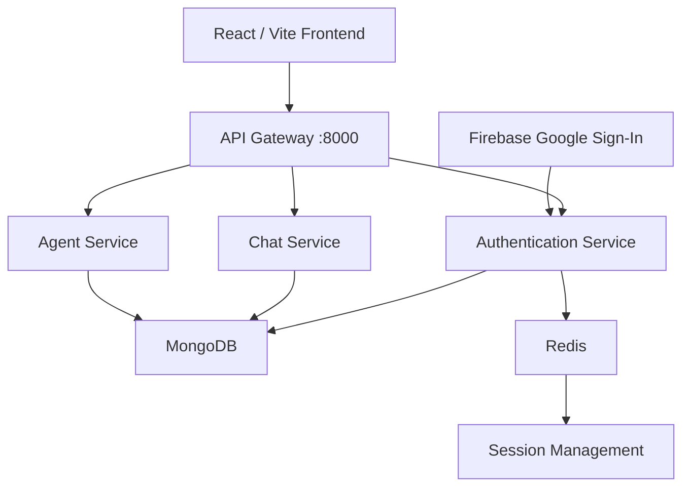

# 🤖 MultiTask AI

<p align="center">
  <strong>A Full-Stack AI Workspace Built with React, Node.js & Microservices</strong>
</p>

<p align="center">
  A modular workspace designed to bring authentication, chat, and AI-powered agent functionality together in one platform.
</p>

<p align="center">
  
  
  
  
  
</p>

---

## 📌 Overview

**MultiTask AI** is a full-stack workspace application built using the MERN ecosystem and a microservices-based backend architecture.

The application separates its core responsibilities into dedicated services for authentication, chat, and AI agents, with an API Gateway managing communication between the frontend and backend services.

The project focuses on modular architecture, session-based authentication, scalable service organization, and future AI-powered functionality.

## ✨ Features

- 🔐 **Google Authentication** — Sign in using Firebase Google Authentication.
- 🍪 **Session Management** — Manage user sessions with Redis.
- 🚪 **API Gateway** — Centralized entry point for backend services.
- 💬 **Chat Service** — Dedicated service for chat functionality.
- 🧠 **AI Agent Service** — Modular service for AI agent integration.
- ⚡ **Microservices Architecture** — Independent backend services.
- 🔒 **Protected Routes** — Session-protected endpoints for authenticated users.
- 🗄️ **MongoDB Integration** — Persistent data storage.
- 🖥️ **React + Vite Frontend** — Fast and modern development experience.

## 🏗️ Architecture



### Backend Services

| Service | Responsibility |
|---|---|
| API Gateway | Centralized API entry point and request routing |
| Auth Service | Google sign-in, user authentication, and session management |
| Chat Service | Chat-related functionality |
| Agent Service | AI agent functionality |
| Redis | Shared session storage |
| MongoDB | Database for backend services |

## 🛠️ Tech Stack

### Frontend
- React
- Vite
- JavaScript
- Redux Toolkit
- React Router

### Backend
- Node.js
- Express.js
- Microservices Architecture
- API Gateway

### Database & Authentication
- MongoDB
- Mongoose
- Redis
- Firebase Authentication
- Firebase Admin SDK

### Development Tools
- Docker
- Docker Compose
- Git
- GitHub
- npm

## 📂 Project Structure

```text
MultiTaskAI/
│
├── backend/
│   ├── gateway/
│   │   ├── routes/
│   │   ├── middleware/
│   │   └── server.js
│   │
│   ├── services/
│   │   ├── auth/
│   │   │   ├── models/
│   │   │   ├── routes/
│   │   │   └── server.js
│   │   │
│   │   ├── chat/
│   │   │   └── server.js
│   │   │
│   │   └── agent/
│   │       └── server.js
│   │
│   ├── shared/
│   │   └── redis/
│   │
│   └── docker-compose.yml
│
└── frontend/
    ├── src/
    │   ├── components/
    │   ├── pages/
    │   ├── features/
    │   ├── app/
    │   └── main.jsx
    │
    ├── public/
    └── package.json
```

## ⚙️ Getting Started

Follow these steps to run MultiTask AI locally.

### 1. Prerequisites

Make sure you have installed:

- [Node.js](https://nodejs.org/)
- npm
- [Docker Desktop](https://www.docker.com/products/docker-desktop/)
- MongoDB connection
- Firebase project with Google Sign-In enabled

### 2. Clone the Repository

```bash
git clone https://github.com/YOUR_USERNAME/MultiTaskAI.git

cd MultiTaskAI
```

### 3. Configure Environment Variables

Create `.env` files in the relevant service directories.

#### Frontend — `frontend/.env`

```env
VITE_BACKEND_URL=http://localhost:8000
VITE_FIREBASE_API_KEY=your_firebase_api_key
```

#### API Gateway — `backend/gateway/.env`

```env
FRONTEND_URL=http://localhost:5173

AUTH_Service_URL=http://localhost:8001
CHAT_Service_URL=http://localhost:8002
AGENT_Service_URL=http://localhost:8003

PORT=8000
```

#### Authentication Service — `backend/services/auth/.env`

```env
MONGODB_URI=your_mongodb_connection_string

PORT=8001

SESSION_NODE_ENV=development
REDIS_URL=redis://localhost:6379
```

Configure the MongoDB URI and required environment variables for the Chat and Agent services as well.

> ⚠️ Ensure every backend service uses a unique port. The Chat and Agent services must not run on the same port.

### 4. Configure Firebase Admin SDK

Download your Firebase Admin SDK service-account JSON file from your Firebase project.

Place it at:

```text
backend/services/auth/
└── multitaskai-29234-firebase-adminsdk-fbsvc-5046364eb0.json
```

**Important:** Never commit the Firebase service-account file or private key to GitHub.

### 5. Start Redis

From the backend directory:

```bash
cd backend

docker compose up -d redis
```

Verify that Redis is running:

```bash
docker ps
```

### 6. Start the Backend Services

Install dependencies and run each service in a separate terminal.

#### API Gateway

```bash
cd backend/gateway

npm install
npm run dev
```

#### Authentication Service

```bash
cd backend/services/auth

npm install
npm run dev
```

#### Chat Service

```bash
cd backend/services/chat

npm install
npm run dev
```

#### Agent Service

```bash
cd backend/services/agent

npm install
npm run dev
```

### 7. Start the Frontend

```bash
cd frontend

npm install
npm run dev
```

Open the application in your browser:

```text
http://localhost:5173
```

## 🔌 API Gateway

The API Gateway runs on:

```text
http://localhost:8000
```

| Endpoint | Description |
|---|---|
| `/getuser` | Fetch the currently authenticated user |
| `/auth` | Authentication-related routes |
| Chat routes | Chat service functionality |
| Agent routes | AI agent functionality |

The gateway forwards requests to the appropriate backend service based on the configured service URLs.

## 🔐 Security

- Session-based authentication
- Redis-backed session storage
- Protected backend routes
- Firebase Google Sign-In
- Environment variables for sensitive configuration
- Private Firebase Admin credentials
- Git-ignored `.env` files

## 🚀 Future Improvements

- [ ] Complete AI agent integration
- [ ] Integrate an AI provider for assistant responses
- [ ] Complete chat functionality
- [ ] Real-time messaging using WebSockets
- [ ] Improve workspace management
- [ ] Add conversation history
- [ ] Enhance UI/UX
- [ ] Add deployment configuration

## 📜 Available Frontend Scripts

```bash
npm run dev       # Start development server
npm run build     # Build production application
npm run lint      # Run ESLint
npm run preview   # Preview production build
```

## 🤝 Contributing

Contributions, ideas, and suggestions are welcome.

1. Fork the repository.
2. Create a new branch.
3. Make your changes.
4. Commit your changes.
5. Submit a Pull Request.

## 👨‍💻 Developer

**Shubham Padhy**

Full-Stack Developer | MERN Stack | AI & Game Development

- GitHub: [@shubhampadhy512](https://github.com/shubhampadhy512)

---

<p align="center">
  ⭐ If you find this project interesting, consider giving it a star!
</p>

<p align="center">
  <strong>MultiTask AI — One Workspace. Multiple Possibilities. 🚀</strong>
</p>
